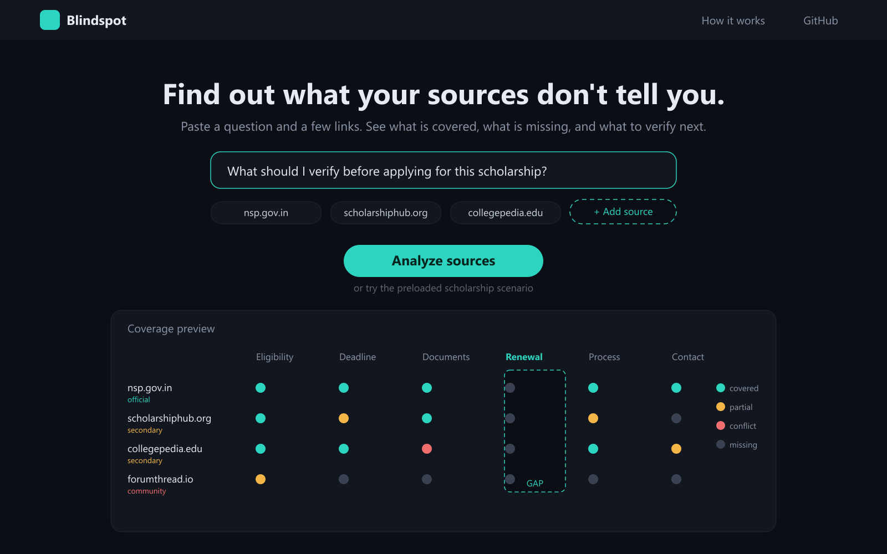
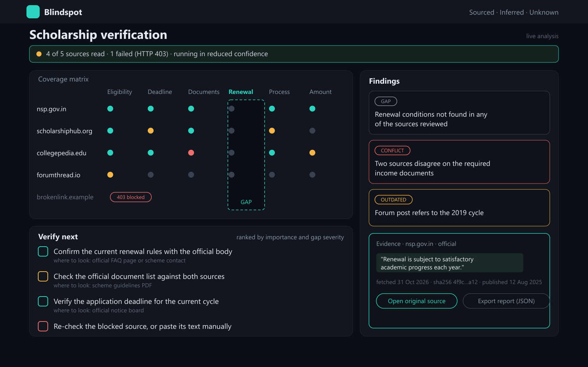

<div align="center">

# Blindspot

**Find out what your sources don't tell you.**

An information-gap auditor for the web. Paste a question and a few links — Blindspot shows what the sources cover, what they miss, where they disagree, and what you should verify next, with every claim tied to a verified quote.

Built for **SHINCHAN Online Hackathon 2026** · *Digital Dark Spot — AI-Assisted Information Gap Detection Platform*

</div>





---

## The problem

People make decisions about scholarships, visas, jobs and public services using information scattered across several websites. Search finds pages and summarizers condense pages, but neither tells you **what is missing**. A page can be accurate, current and confident while still not answering the question you actually need answered.

The dangerous failures are quiet ones:

- an eligibility page that never mentions renewal conditions;
- two pages listing different required documents;
- a blog describing last year's application cycle;
- no source at all stating the deadline.

A fluent AI answer hides these holes by filling them with plausible text. Blindspot is built to do the opposite: to **surface absence**, and to prove every finding it reports.

## What Blindspot does

Given a question and a set of sources, it produces:

1. **A coverage matrix** — every source scored against every aspect a complete answer would need.
2. **Key facts found** — verified statements, each with its quote and source.
3. **Gaps** — aspects no reviewed source addresses, phrased as unanswered questions.
4. **Conflicts** — aspects where sources disagree, shown side by side with authority and date.
5. **Staleness and deadline warnings** — old cycles, undated pages, deadlines already passed.
6. **A prioritized verification checklist** — what to check next, ranked, with a "where to look" hint.
7. **An explicit confidence state** — a run with unreadable sources or rejected quotes is marked *reduced confidence*, never silently smoothed over.
8. **An exportable JSON report** with quotes, URLs, fetch dates and content hashes.

## The core idea: the coverage matrix

<empty cells are gaps, ⚠ marks a conflict; the example below is illustrative.

```
                 Eligibility  Deadline  Documents  Renewal  Process  Amount
nsp.gov.in           ●●●        ●●●       ●●●        ○○○      ●●●      ●●●     official
scholarshiphub.org   ●●●        ●●○       ●●●        ○○○      ●●○      ○○○     secondary
collegepedia.edu     ●●●        ●●●       ⚠⚠◐        ○○○      ●●●      ●●○     secondary
forumthread.io       ●●○        ○○○       ○○○        ○○○      ○○○      ○○○     community
                     ────────────────────────────────────────────────────
                    covered     covered   CONFLICT    GAP     partial  partial
```

The grid is the product. Gaps are empty columns, conflicts are cells where verified claims disagree, staleness is per-source metadata. Everything else — the findings list, the checklist rank, the confidence state — is derived from it.

## How it works

| # | Stage | What happens | Decided by |
|---|---|---|---|
| 1 | **Aspect decomposition** | The question is expanded into 3–6 aspects with search keywords. A generic set is used if the model is unavailable. | LLM, code fallback |
| 2 | **Fetch and snapshot** | The URL is validated, private hosts are blocked, redirects are followed manually, size and time are capped, then readable text is extracted and frozen: `sha256`, `fetchedAt`, detected date and confidence. | Code |
| 3 | **Chunk and retrieve** | Text is split into sentence-aligned chunks (~1,200 chars, ~200 overlap). Each aspect retrieves its best chunks by lexical BM25-style scoring, so no extra API calls are spent. | Code |
| 4 | **Claim extraction** | One model call receives every source excerpt plus the aspect list, and must return `{ sourceId, aspectId, statement, quote }` with quotes copied character-for-character. | LLM |
| 5 | **Quote verification** | Each quote is located in the frozen text: exact, then NFKC-folded (curly quotes, dashes, NBSP, whitespace), then fuzzy with ≥90 % token containment. A quote that cannot be found is **discarded**, and a claim attributed to the wrong source is reassigned if another source contains it. | Code |
| 6 | **Coverage scoring** | Covered / partial / missing, computed from verified claims only, weighted by quote length and whether the quote carries a number or date. | Code |
| 7 | **Conflict detection** | Typed values (percentage, money, date, duration) are compared in code; the model is asked only to adjudicate the remaining text claims, one batched call. | Code first, LLM to confirm |
| 8 | **Staleness** | Publish date from JSON-LD → meta tags → `<time>` → visible text, each with a confidence label. `Last-Modified` is deliberately ignored as a publish signal. Plus a deadline-passed check. | Code |
| 9 | **Checklist ranking** | Conflicts rank above gaps, gaps above staleness, staleness above retrying a failed link. Each item carries a "where to look" hint. | Code |

Two design rules run through the whole pipeline:

- **Deterministic first, LLM second.** The model extracts and classifies; code decides. Anything computable without a model is computed without one.
- **Partial success is normal.** A failed source never fails the analysis. It appears as an unavailable row with a reason, and the run is marked reduced confidence.

A run costs at most three model calls regardless of source count, which keeps a free-tier key usable.

## Why the quote verifier matters

Most "AI research" tools cite by generating a plausible reference. Blindspot inverts the trust model:

1. The model may only answer with **quotations from supplied text**.
2. The server independently checks that each quote exists in the stored snapshot.
3. If verification fails — because the quote was paraphrased, invented, or mismatched — the claim is **discarded before it can affect any score**.

This means the product visibly distrusts its own model, and a judge can falsify any finding by opening the source. It is also the cheapest possible defence against the most common LLM failure mode.

Verification is deliberately forgiving about formatting (curly vs straight quotes, non-breaking spaces, dashes, line breaks) and strict about substance: a quote must be nearly fully contained in the source, so a rewritten sentence fails.

## Trust model: what each state means

There are no "AI says" rows in the interface. A cell is one of five states, and only one of them comes from the model at all:

| State | Meaning | Produced by |
|---|---|---|
| **Covered** | Two strong verified quotes, or one quote with a concrete value | Code, over verified quotes |
| **Partial** | A verified but thin statement | Code, over verified quotes |
| **Conflict** | Verified claims from two sources cannot both be true | Code, then one model adjudication pass |
| **Missing** | No verified statement about this aspect in any readable source | Code |
| **Unavailable** | The source could not be read, so nothing can be concluded about it | Code |

A gap always carries the caveat: *missing among the sources reviewed — not necessarily absent from the world.* When a source failed, the gap text says so explicitly.

## Safety and privacy

Feeding arbitrary web pages into a model and fetching arbitrary user URLs are both untrusted operations, so both are treated as such.

**Server-side request forgery (SSRF).** All fetching goes through one guarded function: scheme allowlist (`http`/`https` only), credential and port rejection, DNS resolution followed by checks against loopback, private, link-local, CGNAT and IPv6 equivalents, manual redirects with the guard re-run on every hop, an 8–10 s timeout and a hard 2 MB cap. Known limitation: DNS rebinding is not fully solved by an address check alone; the production fix is connecting to the pre-validated IP through a custom dispatcher.

**Prompt injection.** Fetched text is untrusted data: it is passed inside explicit delimiters, the system instruction states that nothing inside them is an instruction, model output can never trigger a fetch or tool call, all output is schema-validated, and the local quote verifier remains the final authority.

**XSS.** Source text and quotes are rendered as text nodes with highlighted spans — never `dangerouslySetInnerHTML`.

**Secrets.** The Gemini key lives in `.env.local` (gitignored), is read only inside route handlers, and is never sent to the browser. `.env.example` ships with an empty value. `git check-ignore` confirms the real file is excluded.

**Abuse control.** Per-IP analysis limit, a global daily cap, and per-request caps (max sources, question length, total text). Limits return a friendly message pointing to demo mode rather than an error.

**Privacy.** No database and no source text in production logs. A run exists only in the browser session and in an export the user chooses to download.

## Source handling

Every URL failure is a typed code with a human message, so one bad link never poisons a run.

| Code | User sees | Next action |
|---|---|---|
| `INVALID_URL` | "This does not look like a valid link" | fix the link |
| `UNSUPPORTED_SCHEME` | "Only http and https links are supported" | use a web link |
| `CREDENTIALS_IN_URL` | "Links with a username or password are not allowed" | remove them |
| `BLOCKED_PORT` | "This port is not allowed" | use a standard web port |
| `BLOCKED_HOST` | "This address cannot be fetched for security reasons" | use a public URL |
| `DNS_FAIL` | "Could not find this website" | check the address |
| `TIMEOUT` | "Reading this source took longer than 24 seconds" | retry, or paste the text |
| `HTTP_ERROR` | "This site blocks automated reading (HTTP 403)" · "This page no longer exists (HTTP 404)" · "rate-limiting (HTTP 429)" · "server error (HTTP 5xx)" | open in a browser and paste the text |
| `UNSUPPORTED_CONTENT_TYPE` | "PDF files cannot be read yet" or the content type named | paste the text |
| `EMPTY_CONTENT` | "builds its content with JavaScript" · "only N words of readable text — a placeholder or link index" | paste the text |
| `REDIRECT_LOOP` | "This link redirects in a loop" | use the final URL |
| `NETWORK_ERROR` | "Could not connect to this source (CODE)" | retried once automatically, then paste the text |

Each URL gets a **12 s socket timeout** and a **24 s total budget** covering every redirect hop, so a slow host or a redirect chain cannot hold a request open. Every rejection is logged server-side as one structured `[blindspot:fetch]` line with the URL, hop, status and elapsed time, so a failed source can be traced to a single cause instead of a generic message. Transient socket resets are retried once.

Pages larger than 2 MB are truncated rather than rejected, and the snapshot records `truncated: true`. A short page is still treated as readable; it only fails when there is too little text to audit. A **paste-text** path exists for every source, so a blocked page is never a dead end.

## How this differs from existing tools

| Tool | What it does | What it cannot do |
|---|---|---|
| Search engines | find pages | no notion of completeness |
| Summarizers | condense what exists | cannot report what is absent |
| Chat assistants | produce a fluent answer | fill gaps with plausible text |
| Deep-research agents | write a report | optimise for narrative coherence, not auditability |
| NotebookLM-style tools | Q&A over your documents | no gap model, no conflict ledger, no staleness |
| **Blindspot** | **audits coverage of a question by a source set** | doesn't pretend to know the answer |

The positioning in one line: **we don't answer the question, we audit the answering.** The LLM is a component under an evidence system, not the product.

## Tech stack

- **Next.js 16** (App Router, Cache Components) + **React 19** + **TypeScript** + **Tailwind CSS v4**
- **`@google/genai`** — Gemini for aspect decomposition, claim extraction and conflict adjudication
- **`@mozilla/readability`** + **`jsdom`** for article extraction
- **Zod** for validating every model response and API payload
- **No database, no vector store, no agent framework** — a run is one JSON object held in the browser session

Retrieval inside a source is lexical (BM25-style scoring over sentence chunks) rather than embedding-based: it is deterministic, costs no API calls, and keeps the per-analysis budget at three model calls.

Model IDs live in `lib/gemini.ts` with a fallback chain, because provider model IDs change.

**Why each of these choices was made, in terms of the problem statement, is documented in [`TECH-STACK.md`](TECH-STACK.md).**

## Getting started

```bash
git clone https://github.com/sumitk-io/Blindspot.git
cd Blindspot
npm install --legacy-peer-deps
```

Create `.env.local` from the example and add your key:

```bash
cp .env.example .env.local        # macOS / Linux
Copy-Item .env.example .env.local # Windows PowerShell
```

```dotenv
GEMINI_API_KEY=your_key_here
# optional
GEMINI_MODEL=
DAILY_ANALYSIS_CAP=200
```

Run it:

```bash
npm run dev        # http://localhost:3000
npm run smoke:all   # guarded fetch + quote verifier + pipeline + rate limits
npm run build       # production build
```

Get a free key at [Google AI Studio](https://aistudio.google.com/apikey). The key is read server-side only; it never reaches the browser.

### Deploying

Import the repo into Vercel, add `GEMINI_API_KEY` as an environment variable, deploy. Adding or changing a variable requires a redeploy. Set the route's `maxDuration` to match your plan's limits, and confirm the library bundling works on serverless before relying on it.

## Demo mode

The **Load demo scenario** button opens a **pre-saved analysis result** produced by an earlier real run, committed to the repository. It makes **zero** model calls.

That is a deliberate reliability decision, not a shortcut: the demo still works with an exhausted quota, a dead venue network, or a provider outage. A badge distinguishes *Demo — saved result* from *Live analysis*, so the claim is never misleading.

The saved run is regenerated with:

```bash
npm run demo:save -- "Your question" https://source-a.example https://source-b.example
```

which fetches the sources, runs the full pipeline and writes `lib/demo-saved.json`.

## Project structure

```
app/
  page.tsx                     landing page
  ask/page.tsx                 question + sources, live page checking, paste-text fallback
  analysis/[id]/page.tsx       saved demo dashboard (/analysis/demo)
  analysis/live/page.tsx       live dashboard, read from sessionStorage
  api/analyze/route.ts         snapshots → pipeline → AnalysisData
  api/fetch-source/route.ts    URL → snapshot preview (title, words, date)
components/
  analysis-view.tsx            coverage matrix, findings, checklist, evidence
  landing/…, ask/…             design-matched UI
lib/
  safe-fetch.ts                URL validation, SSRF guard, size/time caps
  extract.ts                   readability + metadata + date confidence
  snapshot.ts                  frozen source: text, sha256, dates, failure reason
  gemini.ts                    client, model fallback, JSON parsing and retries
  rate-limit.ts                per-IP and daily caps
  pipeline/
    text.ts                    chunking, retrieval, quote verification, value extraction
    model-stages.ts            aspects, claims, conflict audit
    analyze.ts                 coverage, conflicts, staleness, checklist, evidence
scripts/
  smoke-*.mts                  executable checks (see Testing)
  save-demo.mts                freezes a real run as the demo
docs/                          screenshots used in this README
```

## Output contract

One type, `AnalysisData` in `lib/types.ts`, shared by server and client:

```ts
type AnalysisData = {
  question: string;
  statusLine: string;        // "3 of 3 sources read · 14 quotes verified"
  reducedConfidence: boolean;
  sources: Source[];         // domain, url, authority, status, failure note
  aspects: Aspect[];         // id, label, icon, tint
  cells: Cell[];             // aspectId × sourceId → covered | partial | conflict | missing | unavailable
  findings: Finding[];       // gap | conflict | outdated
  checklist: ChecklistItem[];// text, whereToLook, priority
  evidence: Evidence;        // best verified quote + sha256 + counts
};
```

Only claims whose quote was located in the frozen source text can influence `cells`, `findings` or `evidence`.

## Testing

The deterministic core is tested by runnable scripts, because that is where correctness is provable:

```bash
npm run smoke:fetch     # 12 URL-guard cases against live and hostile input
npm run smoke:text      # quote verifier, chunking, typed-value extraction
npm run smoke:pipeline  # full analysis with stubbed model calls, plus degradation
npm run smoke:limits    # per-IP window and daily cap
```

Covered explicitly:

- **URL guard** — loopback, private ranges, link-local and cloud-metadata addresses, bad schemes, credentials in URL, disallowed ports, redirects
- **Quote verifier** — exact match, curly quotes, non-breaking spaces, collapsed whitespace, a dropped word (fuzzy), and rejection of a fabricated quote and of quotes shorter than 24 characters
- **Pipeline** — verified/rejected counts, coverage states, numeric and date conflicts, passed deadlines, old pages, gap wording, checklist ranking, evidence selection
- **Degradation** — when the model call throws, sentence-level extraction keeps the matrix populated and the run is marked reduced confidence
- **Rate limits** — sixth request in an hour blocked, daily cap enforced, window reset

The model stages themselves are validated by Zod schemas, quote verification and the saved demo result rather than by asserting exact strings.

## Limitations

Stated plainly, because a credibility claim is stronger with its boundaries visible:

- **Aspects bound the search.** The tool can only find gaps it knew to look for. Domain templates and user-editable aspects mitigate this, but they do not remove it.
- **Coverage is source-limited.** Six pages about a topic are not the internet. "Missing" means missing here.
- **Date extraction is heuristic.** A page with no machine-readable date and no visible date is honestly marked *undated*, not guessed.
- **Conflicts are disagreements, not verdicts.** The tool shows that sources differ and who is more authoritative; it does not establish truth.
- **LLM error is mitigated, not eliminated.** Quote verification removes hallucinated citations; it cannot fix a model that misreads a real sentence.
- **Free-tier quotas are finite.** Hence demo mode and rate limits.

## Roadmap

- PDF and DOCX ingestion through the same snapshot contract
- Shareable, frozen analysis permalinks
- Re-check: compare stored hashes to detect when a source changed
- Scheduled monitoring — which cells filled in or broke since last month
- Cross-lingual sources
- More domain templates: visas, admissions, tender specs, medical guidance
- Browser extension to add an open tab as a source
- Search-API source discovery
- Calibration report — precision and recall of gap detection against a hand-labelled set

## Hackathon mapping

| Expected outcome in the brief | Where it lives |
|---|---|
| Enter a topic, question or research goal | Ask screen |
| Add or collect sources | URL input, paste-text fallback, demo snapshots |
| Structured summary of key information | Key facts section with quote per fact |
| Gaps and unanswered questions | Gap findings + matrix empty cells |
| Contradictions with references | Conflict findings with side-by-side quotes |
| Outdated or undated warnings | Staleness and deadline checks |
| Prioritized verification checklist | Ranked checklist with where-to-look hints |
| Dashboard separating sourced / AI / uncertainty | Coverage states (covered, partial, conflict, missing, unavailable) with verified quotes |

Judging guidance from the brief is respected literally: findings are labelled as potential gaps, not facts; every important finding exposes its source reference; and the gap-detection workflow — not a chat window — is the demonstration.

## Name

The name currently appears in `app/layout.tsx` (metadata), the landing page and header components, and `package.json`. Renaming is a small, contained change.

## License

MIT — see `LICENSE`.

## Acknowledgement

Built solo for the SHINCHAN Online Hackathon 2026. The scholarship scenario is illustrative; sample sources are clearly identified as samples, not as authoritative guidance.
